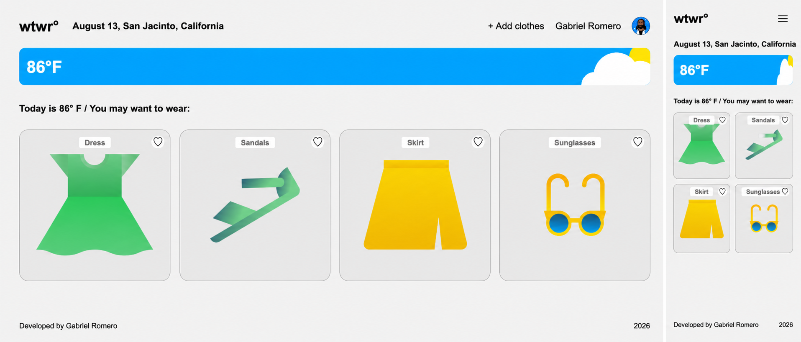

# WTWR

WTWR is a responsive weather-based clothing recommendation app. It displays the current temperature, filters clothing suggestions by weather condition, supports Fahrenheit and Celsius, and includes a profile page for managing clothing items.



## Technologies

- React
- Vite
- JavaScript
- CSS media queries
- React Router
- React Context API
- Custom `useForm` hook
- json-server mock API
- OpenWeather API
- Prettier for consistent code formatting

## Running locally

Install the dependencies:

```bash
npm install
```

Start the mock API:

```bash
npm run server
```

In a second terminal, start the React application:

```bash
npm run dev
```

To use live weather data, add an OpenWeather API key to `.env`:

```bash
VITE_OPENWEATHER_API_KEY=your_api_key
```

The app uses San Jacinto, California as its default location and shows fallback weather data when the key is missing or the request fails. The mock clothing API runs at `http://localhost:3001`.

## Project pitch video

[Watch the WTWR project pitch video on Google Drive](https://drive.google.com/file/d/1e0KhMCgZBaBdlMv7soX721Pei-ui0Iqm/view?usp=sharing)

Run `npm run format` to format the project with Prettier.
